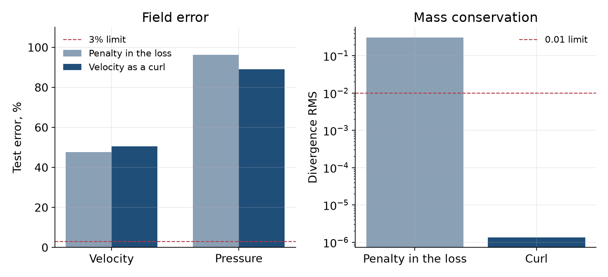

# A cube of flow, predicted in one pass

A cube is full of water. At the start, the water is already moving. The task is to say how it will move for another 0.4 seconds, and what the pressure will be.

A usual solver takes small steps. On every step it turns the field into frequencies and back, many times. That is slow when the same kind of question is asked thousands of times.

Here a network looks at the starting motion and writes the answer at four later times in one pass. It does not write the velocity itself. It writes an auxiliary field, a potential, and the velocity is the curl of that potential. Whatever flows into a point also flows out. Mass is conserved by construction, so the loss does not have to ask for it.

This is a laboratory cube with periodic walls. It is not a wing and it is not a chip cooler.



On the left, the field error stays large. The requested limit was 3%, the red line at the bottom. On the right is the change that actually happened. While divergence was only penalized, it sat near 0.3. Once the velocity became a curl, it fell to about one part in a million. The red line at 0.01 is the “near zero” limit.

## What was asked, and what came out

Measured on an Apple M3 CPU. There is no GPU in this comparison.

| | Asked | Measured |
| --- | --- | --- |
| Velocity and pressure error | both under 3% | velocity 50.5%, pressure 89.1% |
| At least 1000× faster than a traditional solver on the same GPU | yes | no NVIDIA GPU and no OpenFOAM here. Against the spectral solver on CPU, 36× faster: 1.03 s versus 0.029 s |
| Train on a 32³ grid, answer on 128³ with no fine-tuning | both errors under 3% | on 128³, velocity 50.5%, pressure 86.6%. It runs. The limit is missed |
| Divergence near zero | RMS under 0.01 | RMS 1.3×10⁻⁶. Met |

Copying the initial field forward gives a velocity error of 60%. The network gives 50%. It is closer than a frozen picture, and still far from 3%.

## How this version differs from the previous one

At first the network wrote the velocity itself and was penalized when fluid appeared from nowhere. The penalty did not work. Test divergence was 0.31, velocity error 47.6%, pressure error 96.3%. The network was 57× faster than the solver.

Then the velocity was replaced by a curl. Divergence became 1.3×10⁻⁶. Pressure improved a little, to 89%. Velocity error became 50.5%, a bit worse. The speedup fell to 36×, because the curl is a few extra Fourier transforms.

Before that assignment, this folder held a different experiment: a flat picture, one short step, then those steps chained together. That experiment is a different task.

## How it is built

The cube runs from 0 to 2π on each side. Viscosity is 0.05. There is no external force. The reference solves the Navier–Stokes equations with a spectral Runge–Kutta method. The network is a Fourier operator, 4 layers, 886 thousand parameters, trained on 12 trajectories. At the end of training the validation error is still about 70%: there are too few examples, and the network memorizes them.

## Run

```bash
python3.12 -m venv .venv
source .venv/bin/activate
pip install -r requirements.txt
python -m unittest discover -s tests -t .
python -m src.train_spec
```

The numbers are in `runs/spec_metrics.json`.
